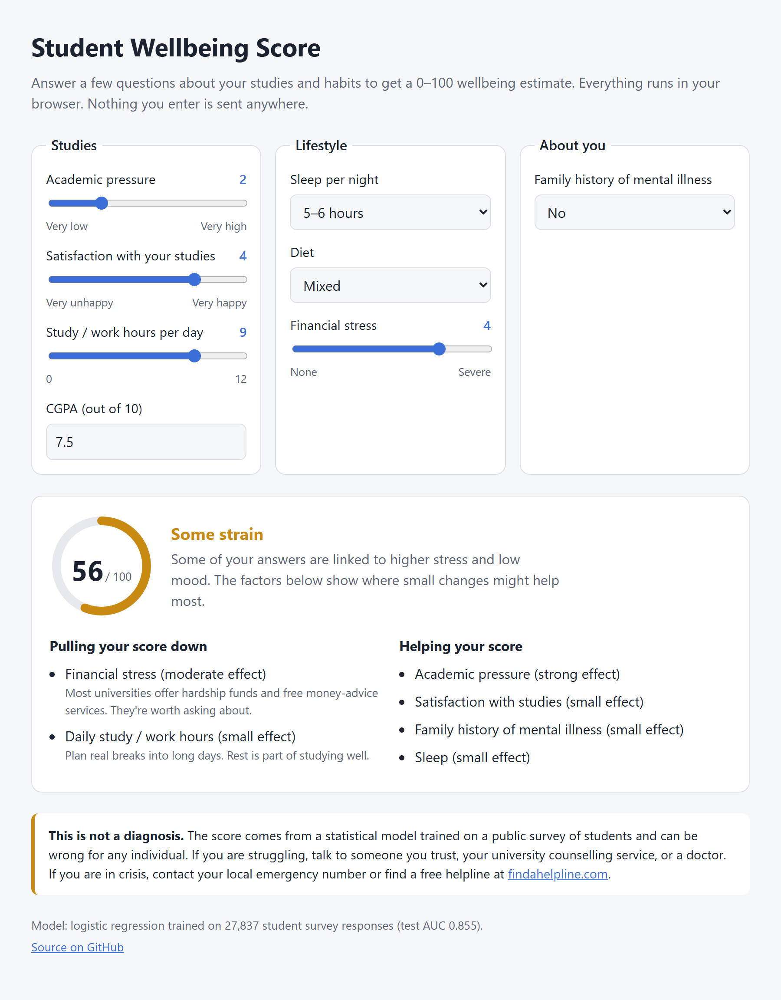

# Student Wellbeing Score

A web app that estimates a 0–100 wellbeing score for students from study and lifestyle habits:
academic pressure, study satisfaction, study hours, financial stress, sleep, diet, CGPA and family
history.

**Live demo:** https://abdullahrasheed452.github.io/MentalHealthScorePredictor/



> This is an educational project, not a medical tool. The score is a statistical estimate and can
> be wrong for any individual.

## How it works

1. `src/train.py` trains a logistic regression on the Kaggle
   [Student Depression Dataset](https://www.kaggle.com/datasets/hopesb/student-depression-dataset)
   to predict the probability that a student reports depression. It also trains a gradient-boosting
   model for comparison.
2. The logistic regression weights are exported to `docs/model.json`.
3. The static site in `docs/` loads those weights and computes
   **score = 100 × (1 − predicted probability)** in the browser. No server is needed, and nothing the
   user enters leaves their device.
4. Each input's contribution to the prediction is shown as a factor that's helping or hurting the score.

## Results

Trained on 27,837 students (58.5% labelled as depression). With 5-fold cross-validation
(`src/compare_models.py`), the site's logistic regression scores **AUC 0.860, accuracy 78.8%**.

**More complex models don't do better.** Interactions, tuned gradient boosting and a random forest
all land within 0.005 AUC of logistic regression (0.855–0.859). Logistic regression is used for the
site because it runs in a few lines of JavaScript and each input's effect can be shown directly.

**More data of the same kind wouldn't help either.** Trained on just 5,000 students the model already
reaches AUC 0.859, and the remaining 22,000 add 0.001. Better accuracy would need *different*
information about each student, not more rows.

### Does it work outside India?

The Kaggle survey comes from India, so the model was also tested, unchanged, on the
[PHQ-9 Student Depression Dataset](https://data.mendeley.com/datasets/kkzjk253cy/6) (682 university
students, CC BY 4.0) using `src/validate_external.py`. That survey uses different questions and
measures depression with the PHQ-9, a standard clinical questionnaire (a score of 10 or more counts as
moderate depression). It shares two of the site's inputs, academic pressure and financial stress.

| Using academic + financial pressure only | AUC |
|---|---|
| Indian students (the training survey) | 0.827 |
| PHQ-9 students (a different survey) | **0.830** |

The model ranks students by depression risk just as well on a survey it never saw. The script first
checks that the data is internally consistent (Cronbach's alpha 0.88, totals match answers), because
a second dataset that was tried failed those checks and was dropped.

### What the site leaves out, and why

- **Suicidal thoughts.** Adding this question raises AUC to about 0.92, but it is too sensitive to
  ask in a public web form, and it is partly a symptom of depression itself.
- **Age.** In the Indian data younger students reported more depression, but on the PHQ-9 students
  age had no effect, and leaving it out made the model carry over better. It also can't be changed.
- **Gender, degree, city.** They add no accuracy and aren't things a student can change.

## Limitations

- **Who the data describes.** The model is trained only on students in India. It held up on a
  second university survey (see above), but that is one test, not proof that it works everywhere.
- **Self-reported answers.** Both the habits and the depression label come from a questionnaire,
  not a clinical assessment.
- **Correlation, not cause.** The model learns which answers tend to appear together. It can't say
  that changing a habit will change how someone feels.
- **A high base rate.** 58.5% of students in the dataset reported depression, far more than in most
  student populations, so scores tend to run low. The site waits until the user has changed an
  answer before showing a score, and keeps scores between 1 and 99.

## Run it yourself

```bash
pip install -r requirements.txt

# 1. Download the dataset from Kaggle and put the CSV in data/raw/
# 2. Train and export the model
python src/train.py

# 3. Optional: compare models, and test on the PHQ-9 survey
#    (download it from Mendeley Data into data/external/ first)
python src/compare_models.py
python src/validate_external.py

# 4. Serve the site locally, then open http://localhost:8000
python -m http.server 8000 --directory docs
```

## Project layout

```
data/raw/                  Kaggle CSV (not committed)
data/external/             PHQ-9 CSV for external validation (not committed)
src/train.py               training + export to docs/model.json
src/compare_models.py      model comparison and learning curve
src/validate_external.py   test on the PHQ-9 survey
models/                    evaluation results (JSON)
docs/            the website (served by GitHub Pages)
```

## Deploying

GitHub Pages serves the `docs/` folder from the `main` branch
(Settings → Pages → Source: *Deploy from a branch* → `main` / `/docs`).
After retraining, commit the new `docs/model.json` and push. The site updates within a minute or two.

## Data credits

- Student Depression Dataset by hopesb, [Kaggle](https://www.kaggle.com/datasets/hopesb/student-depression-dataset).
- PHQ-9 Student Depression Dataset, [Mendeley Data](https://data.mendeley.com/datasets/kkzjk253cy/6), CC BY 4.0.
